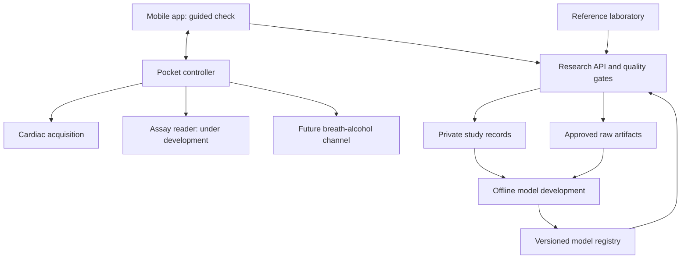

# High-level design

This document preserves the original proposed architecture. Statements about
unsupplied services describe that baseline. For the current executable system,
recorded design changes and remaining work, see
[implementation status](../IMPLEMENTATION_STATUS.md) and the
[requirements alignment audit](../docs/REQUIREMENTS_ALIGNMENT_AUDIT.md).

Version 0.1.0 | 2026-10-10, America/Chicago | Development proposal

## 1. Purpose and architectural boundary

One-The-Go Detection is a proposed pocket reader and mobile application for collecting a standardized saliva measurement, one reaction task, pupil-response measurements, and cardiac measurements in one check. The long-term product also includes a separate breath-alcohol channel. The immediate deliverable is a research and engineering foundation; this repository does not contain a working THC assay or validated intoxication model.

The future scientific target is a defined current functional impairment endpoint in the context of cannabis exposure. Chemical exposure, subjective intoxication, and functional performance must remain separate concepts. The platform must not estimate individual metabolic clearance from one sample, present a negative chemical test as proof of sobriety, or represent a low model score as permission to drive. See [decisions](DECISIONS.md), [PRD](PRD.md), and [validation plan](VALIDATION_PLAN.md).

The consumer interaction constraint is one saliva collection and one continuous game per valid check. The device may collect a time series within that check, such as a pulse waveform, and the game contains multiple trials. Replacing an invalid collection is a retry. Collecting multiple visits during development does not change the intended product workflow.

## 2. System context

This diagram is a proposed architecture, not a deployment inventory. The mobile app owns camera capture and task presentation; those operations do not run on the microcontroller. Reference laboratory reports support analytical comparison and model development. A delayed laboratory result is historical evidence for its collection time, not a real-time consumer measurement.

## 3. Development phases

| Phase | Deliverable | Permitted result | Exit condition |
|---|---|---|---|
| P0: integration | Synthetic telemetry, device transport, game events, measurement record contracts, bench fixtures | measurement_only, invalid, or inconclusive; probability is null | Demonstrated end-to-end provenance, quality flags, clock handling, reproducible records, and absence of enabled inference |
| P1: analytical feasibility | Candidate assay compared with a qualified reference method; bench characterization of optical and cardiac acquisition | Measurement results for their stated analytical purpose; no intoxication probability | Assay feasibility and measurement performance satisfy a predeclared study specification |
| P2: controlled research | Approved protocol, enrollment, independent outcomes, frozen training and evaluation pipeline | research_estimate only for authorized study sessions with an active_research model | Independent validation, uncertainty reporting, repeatability, and intended-use evidence |
| P3: possible product | Reviewed hardware, manufacturing process, usability evidence, appropriate claims and applicable approvals | Requires a new versioned release contract and governance decision | All named release gates closed; not implied by completing P2 |

The system defaults to P0. Installing a model file, switching a UI setting, or having a positive saliva reading cannot enable P2. Authorization comes from server-side study enrollment, protocol status, and a registry manifest signed off by the designated study/model owners.

## 4. Major components and ownership

### 4.1 Pocket controller

The first controller is an Arduino Nano ESP32. Its role is transport, timestamping, signal acquisition coordination, and device health. The supplied sketch is an intentionally small USB serial simulator. Later firmware will add BLE, sensor drivers, bounded buffering, command handling, and calibration references. The [hardware guide](HARDWARE_STARTER_GUIDE.md) gives board-specific details and a staged parts list.

The controller never invents concentrations from a generic electrical signal. A future assay driver must implement the selected assay's calibration, controls, quality rules, environmental compensation, and uncertainty representation. The device records raw observations and references to its calibration; it may produce concentrations only through an approved versioned analytical algorithm.

Cardiac capture and fluid handling are separate subsystems. Saliva must not enter the electronics or the reusable pulse-contact area. ECG begins with a signal simulator. The electrical safety of a body-connected system depends on the whole power, charging, enclosure, cable, and isolation design; selecting an ECG integrated circuit does not establish safety.

### 4.2 Assay subsystem

The assay channel is an explicit unresolved technology decision. Candidates include an electrochemical or optical reader with a selective disposable chemistry. A potentiostat is an instrument for interrogating an electrochemical assay; it does not itself make that assay selective for THC. Before a custom cartridge or PCB is specified, the analytical workstream must establish a viable measurement method in the intended saliva matrix.

The initial analyte candidate is parent THC. THC-COOH and 11-OH-THC remain optional candidates whose analytical feasibility and incremental value must be evaluated. The selected method must distinguish free from total-after-hydrolysis results and preserve units and limits. Evidence behind this decision is summarized in [SOURCES.md](SOURCES.md); detailed experiments are in [VALIDATION_PLAN.md](VALIDATION_PLAN.md).

Expectorated saliva and buffered collection devices are different acquisition configurations. Each receives a distinct collection-method version. A model trained on one configuration cannot silently accept the other. Sample collection, analytical completion, transmission, and inference each have separate timestamps.

### 4.3 Mobile application

Proposed implementation: React Native for workflow and presentation, with native Swift/Kotlin modules for camera timing, stimulus event timing, and BLE integration. No runtime/framework version is claimed tested by these documents. Pin supported versions and device capabilities when implementation begins.

The app guides consent/configuration, device association, profile entry, sample collection, cardiac capture, pupil capture, one game, quality review, and result display. It stores encrypted local records, supports an explicit retry when a measurement fails, and allows cancelation before finalization. After finalization, a correction creates a new record version.

Pupil diameter in millimeters requires a validated scale or geometry. Unscaled image pixels cannot be labeled millimeters. Capture must retain frame timestamps and stimulus timing metadata; an OS request to turn on a light is not automatically the measured light onset. Optical exposure settings remain blocked until reviewed in the optical workstream.

The task runs locally, without network dependence. Response timing uses monotonic native clocks and actual presentation events. A JavaScript timer callback is not accepted as the exact stimulus-onset timestamp. Task configuration and extraction code are versioned; the reference event semantics appear in the LLD.

### 4.4 Backend and study data service

Use a modular Python/FastAPI service rather than multiple independently deployed microservices at inception. Logical modules are identity/authorization, session ingestion, assay import, artifact management, feature extraction, model registry/inference, audit, and study export. PostgreSQL stores structured records; private object storage holds approved raw artifacts. The initial development environment can use local synthetic files without a cloud account.

An optional future AWS deployment uses an authenticated API behind TLS, a containerized service, managed PostgreSQL, private object storage, and a queue for asynchronous feature work. This is a deployment choice consistent with the team's skills, not a requirement to buy cloud services during the first hardware exercises.

Separate account identity from pseudonymous study data. A participant's identity is never part of a BLE advertisement, object key, analytic export filename, or device log. Study authorization is evaluated for each read/write; possession of a session UUID is not authorization.

### 4.5 Feature and model pipeline

The pipeline validates structure, checks cross-field semantics, aligns acquisition times, calculates versioned features, evaluates signal-quality gates, resolves an approved model manifest, and only then performs inference when permitted. It saves the exact input record hashes, manifest ID, model artifact hash, feature code version, and resulting status.

Candidate models start with regularized regression and tree-based approaches. Model selection follows participant-level evaluation, calibration, and incremental-value analysis; algorithm complexity is not a performance claim. The pipeline must support ablation of chemistry, task, eyes, profile, heart rate, and ECG. It must distinguish a personalized mode from a first-use mode rather than substituting a missing personal baseline with zero.

The manifest declares mandatory channels, eligible acquisition/assay/task versions, limits, population, outcome definition, operating threshold, calibration version, baseline mode, timing window, and lifecycle. There are no hard-coded clinical cutoff defaults in the app. A missing required channel yields an inconclusive result unless a separately evaluated manifest explicitly supports that reduced feature set.

## 5. Check lifecycle and data flow

1. The app establishes an authenticated user context or an isolated synthetic local context and creates a session UUID.
2. It records the profile snapshot and any qualified baseline reference that existed before this check.
3. Device association records firmware, hardware revision, calibration references, and clock alignment. A reboot changes the boot identifier and invalidates cross-boot monotonic assumptions.
4. One standardized saliva collection is associated with one sample ID. Every analyte result carries source, method, basis, limits, and quality. Invalid samples never become silent zero concentrations.
5. The app collects pupil and cardiac data using a recorded acquisition configuration, and runs one configured task. Exact component times are retained.
6. Local checks give actionable recapture reasons. A user may cancel; a completed game is not repeatedly rerun until the user achieves a preferred score.
7. The finalized immutable snapshot is ingested idempotently. Approved raw uploads occur separately with content hashes and explicit authorization.
8. The backend validates the snapshot. In P0/P1 it returns measurements only. In P2 it may produce an estimate for the original acquisition time after applying manifest and study gates.
9. The app displays status, exposure measurements, quality, and permitted research output. It never labels delayed or stale evidence as a current real-time assessment.

## 6. Information model

| Entity | Responsibility |
|---|---|
| Participant/profile version | Pseudonymous study linkage, age at check, height, weight, calculated BMI, optional use history, eligibility reference |
| Session | Acquisition context, component references, clock quality, lifecycle, protocol, immutable finalization hash |
| Sample | Collection method, volume/dilution, collection time, lot, contamination/adequacy flags |
| Measurement | Analyte, concentration qualifier, units, basis, assay and calibration, source, uncertainty when available |
| Task run | Configuration hash, practice/scored trial distinction, presentation/input events, quality, extracted features |
| Biometric capture | Modality, hardware/software version, source, sampling/timing, calibrated units, quality, optional raw artifact |
| Artifact | Private storage reference, media type, digest, consent and retention policy, upload verification |
| Model manifest | Endpoint definition, approved scope, eligibility, timing and feature requirements, model and calibration hashes |
| Result | Target time, evaluation time, immutable status, reason codes, optional authorized research estimate, provenance |
| Audit event | Actor, action, object version, outcome, time; no raw physiology or unnecessary personal data |

Contracts live in [../contracts/](../contracts/). They specify the v0.1 exchange boundary; database tables and APIs are proposed rather than implemented.

## 7. Failure behavior and availability

Sensor faults, low sample volume, out-of-range results, poor eye segmentation, motion-corrupted ECG, game interruption, clock uncertainty, incompatible versions, revoked study access, and unavailable models must be distinguishable. The LLD maps these to errors and result reasons.

BLE disconnects do not produce a partial successful record. The receiver detects missing sequence numbers and verifies a completed transfer before accepting a component. Firmware buffers are bounded; overflow becomes a quality failure. After a restart, a new capture is required unless the component can be proven complete and immutable.

The app may collect an authorized session offline and display local quality information. It does not fabricate an estimate when the registry or server is unavailable. Upload replay must be idempotent. Old model outputs remain historical records with their version; a later model generates a linked reanalysis, not an invisible overwrite.

## 8. Security and privacy architecture

The minimum design includes authenticated encrypted transport, per-study authorization, device association, encrypted storage, secrets outside firmware source, signed release artifacts, dependency review, and auditable access. Actual health data and images are excluded from GitHub. Synthetic examples have explicit source flags at every relevant level.

P0 BLE demonstrations are restricted to synthetic data and clearly identified as demonstrations. Before human research telemetry, provision per-device credentials, bind the device identity to the authorized app, reject replayed commands, and review BLE encryption/authentication with the selected mobile libraries. Radio-range proximity alone is not proof of device identity.

Raw camera/ECG capture is opt-in under an approved protocol. Prefer local extraction when raw upload is not required. Collection cannot begin without an applicable retention policy; the protocol names the retention period, access roles, withdrawal behavior, and any lawful retention exceptions. Log metadata rather than recordings or secrets. A backup does not permit indefinite retention outside that policy.

## 9. Alcohol integration boundary

Alcohol remains a separate future subsystem with its own specimen path, calibration, quality control, and result type. The native result is breath alcohol concentration in mg/L. Any conversion to another quantity must have a named configuration and validated justification. The system must not infer an alcohol value from pupil, pulse, or reaction measurements.

A future combined check links alcohol and cannabis channels by session, while preserving both outputs and acquisition times. The presence of alcohol is a covariate and validation stratum for the cannabis model. An unsupported combination yields an inconclusive cannabis estimate; adding two impairment scores is not specified.

## 10. Delivery sequence and architectural risks

The [roadmap](ROADMAP.md) turns this design into work packages. First demonstrate synthetic telemetry and record validation; then add a real pulse channel; then a reproducible game and guided eye capture; independently establish assay feasibility; only then collect approved paired data. A custom enclosure and PCB follow stable sensor and power requirements.

The main risks are selective quantitative saliva sensing, inability to identify a sufficiently useful impairment endpoint, confounding and poor generalization, measurement drift, interaction burden, and unproven economics. Each has an experiment and owner in the full specification and validation plan. The architecture deliberately allows the team to stop or change an assay without rewriting the app, data contracts, or evidence trail.
