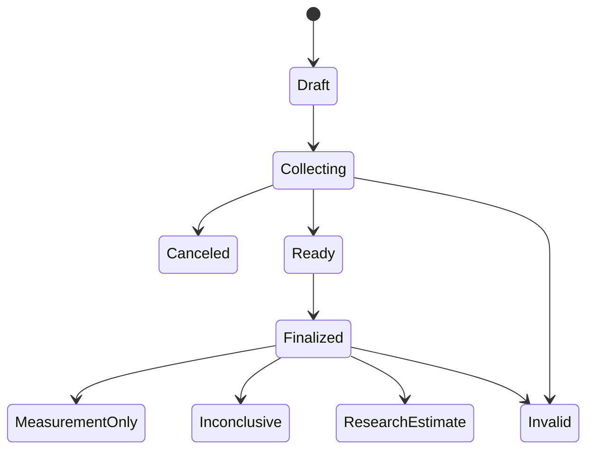

# Low-level design

This document preserves the original proposed implementation contract. Its
starter-only status and proposed module paths describe that baseline. The
current source uses `apps/mobile`, `services/api`, `infra` and `deploy`; see
[implementation status](../IMPLEMENTATION_STATUS.md) and the
[requirements alignment audit](../docs/REQUIREMENTS_ALIGNMENT_AUDIT.md) for
implementation details, recorded deviations and remaining work.

Version 0.1.0 | 2026-10-10, America/Chicago | Proposed implementation contract

## 1. Scope and implementation status

This document defines module boundaries, record semantics, acquisition timing, transport, persistence, model gating, errors, and verification for the design in [HLD.md](HLD.md). The only executable starter supplied is synthetic serial telemetry, a local measurement-only demonstration, and specification verification tools. The mobile application, API service, BLE firmware, sensing electronics, assay, and inference engine are not implemented by this document.

Normative product requirements are indexed in [FULL_SPECIFICATION.md](FULL_SPECIFICATION.md). Structural exchange contracts are in [../contracts/](../contracts/). The JSON Schemas use Draft 2020-12; API design uses OpenAPI 3.1. Version changes that alter units, meaning, required fields, timing, or model compatibility require migration and a new manifest, not merely a renamed UI label.

## 2. Proposed module layout

| Module | Owns | Explicit boundary |
|---|---|---|
| firmware/transport | USB diagnostics, later BLE framing, sequence tracking, bounded queues | No clinical inference and no cloud credentials |
| firmware/acquisition | Sensor drivers, monotonic timestamps, device health, signal-quality flags | No concentration algorithm until the assay/calibration is selected |
| mobile/session | Workflow, retries, finalization, local encrypted persistence | Cannot authorize a research model or modify finalized records |
| mobile/task_native | Stimulus presentation and input timing | No network call on the scored-trial timing path |
| mobile/eye_native | Camera capture, frame timestamps, approved stimulus configuration | No assumption that pixels are millimeters or flash request time is actual light onset |
| mobile/device_native | BLE association, clock alignment, verified component transfer | Rejects unexpected device/session identifiers |
| backend/ingest | Authorization, contracts, idempotency, immutable writes | Does not trust client-supplied model authorization |
| backend/features | Versioned deterministic extraction and quality gates | Never reads outcome labels or future visits while extracting inputs |
| backend/registry | Manifests, hashes, scope, review history | Client cannot promote lifecycle or change thresholds |
| backend/inference | Ordered gate evaluation and permitted research scoring | No estimate for simulation, an unvalidated model, or an unauthorized study |
| research/evaluation | Grouped splits, calibration, ablation, independent outcomes | Evaluation labels stored separately from deployable input snapshots |

These paths describe the intended application implementation. They are not directories populated with application code in this initial commit.

## 3. Identifiers, clocks, and immutable records

Use UUIDs for session, sample, task, result, and artifact identifiers. A device has a provisioned identifier plus a fresh boot identifier after restart. Device boot identity distinguishes a reset counter from the continuation of an earlier capture. The synthetic serial example uses a visibly synthetic device identifier and a monotonic sequence for its limited demonstration scope.

Use RFC 3339 UTC timestamps for acquisition start/end, sample collection, assay completion, finalization, and evaluation. Store monotonic elapsed milliseconds for on-device event order and task responses. Do not calculate reaction times by subtracting wall-clock timestamps.

Clock alignment records offset and uncertainty. A proposed later BLE synchronization exchange sends a phone monotonic timestamp, receives device receive/send counters, and calculates an offset interval from the round trip. Repeat exchanges and retain the narrowest valid interval. Do not claim uncertainty smaller than the observed transport and timestamp resolution. A device reboot, clock discontinuity, or inability to align a required component triggers a timing quality failure.

Each research manifest defines the maximum acquisition span and maximum clock uncertainty it supports. These limits have no clinical defaults. P0 may exercise proposed integration limits, but they cannot authorize inference. Store both target_at, the time represented by the check, and evaluated_at, when analysis finishes. A laboratory result returned later remains tied to its original collection time.

The submitted acquisition snapshot uses capture_completed_at for client capture completion; the server records finalized_at separately when it freezes the accepted snapshot. Unfinished or canceled draft state is not serialized as a completed snapshot. Not-collected components have null acquisition timestamps and features; their actual trial counts are zero. Allocated sample, task, and configuration identifiers may identify a planned attempt but do not establish that acquisition occurred. When saliva was not collected, its collection time is null and the saliva measurement list is empty. With no observed acquisitions, acquisition_span_ms is null. Unrun analytes use not_measured with null analysis time, method, instrument, and calibration; an actual collected specimen is still required for such an analyte record.

Finalized snapshots are immutable. Their digest is SHA-256 over the exact canonical UTF-8 JSON serialization defined by the implementation version. Before adopting a cross-language canonicalizer, select and test a published canonicalization scheme; the local starter uses sorted keys and compact separators only for its Python demo. A correction creates a new snapshot and records supersedes_session_id; derived results reference the precise input digest.

## 4. Saliva measurement contract

The measurement envelope contains measurement_id, sample_id, analyte, qualifier, value_ng_ml, unit, assay_basis, concentration_basis, correction_status, limits, source, method_id, calibration_id, cartridge_lot, collected_at, measured_at, and quality_flags. Original reported value/unit/qualifier and an optional uncertainty are retained when importing reference data. Sample-level collection method, volume, and dilution are recorded once in the session's sample object.

Canonical analytes are THC, THC_COOH, and OH11_THC. Canonical concentration unit is ng/mL. Convert pg/mL by dividing by 1000; therefore 15 pg/mL becomes 0.015 ng/mL. Preserve the original report so the conversion is auditable. Never infer a saliva-to-blood conversion or interpret a quantification limit as an impairment threshold.

| qualifier | value_ng_ml | Required interpretation |
|---|---|---|
| quantified | Nonnegative number inside the validated quantification interval | Exact reported quantitative result; limits and calibration must be available for model eligibility |
| below_loq | null | Below the quantifiable range; retain the applicable limit and the original qualifier; detection is not inferred |
| above_range | null | Above the validated interval; retain the upper bound; do not substitute that bound as an exact result |
| not_detected | null | No detection using the stated method and limit; not proof of zero analyte |
| not_measured | null | Channel absent or not run; not a chemical negative |
| invalid | null | Collection, control, sensor, or analytical failure; reason flags required |

A laboratory report stating only BLQ or <LLOQ does not necessarily assert detection. Preserve that original qualifier and do not convert it to a claim that a metabolite was detected.

The schema covers structure and simple conditional rules; ingestion must also enforce limit order, numeric finiteness, value-within-range, timestamp order, sample identity, and unit consistency. Import adapters must not silently clip an over-range value. Reanalysis after dilution produces a linked new measurement with its actual method, dilution, and result; it does not edit the original record.

assay_basis is free, total_after_hydrolysis, or unspecified. The unspecified state allows preservation of an unresolved import but blocks a model requiring a defined form. A model must enumerate method/basis combinations it accepts. Laboratory hydrolysis benchmarks do not establish the performance of a direct cartridge measuring only free analyte.

concentration_basis is neat_oral_fluid, collected_mixture, or unspecified and applies to the original report, canonical concentration, analytical limits, and uncertainty. correction_status is not_corrected, laboratory_corrected, or unspecified and records whether the reporting laboratory applied a dilution correction. These fields describe a separate issue from free versus hydrolyzed analyte. The import path converts units only; it never multiplies by the session dilution factor. An unknown reporting basis is preserved and blocks incompatible inference. A later scientifically justified transformation requires an explicit versioned adapter and new linked record; never silently correct twice.

The manifest's compatibility_policy_id must resolve to an immutable policy of accepted analyte/method/assay_basis/concentration_basis/correction_status tuples, including collection-method compatibility. Independent allowed_assay_ids and allowed_assay_bases lists are preliminary filters, not permission for their Cartesian product. A missing or unresolved tuple policy blocks inference.

source is simulated, reference_lab, prototype_sensor, or validated_sensor. A provenance string alone is not evidence of validation: the registry verifies the claimed method and calibration. Every concentration emitted by the starter is simulated and is prohibited from research inference.

## 5. Cardiac and pupil capture records

The v0.1 cardiac envelope describes one capture modality. PPG cannot populate ECG-derived fields; an ECG-derived metric requires an ECG capture and its provenance. A future design acquiring PPG and ECG together must represent separate capture identities and timing before extending this envelope.

### 5.1 Heart rate and ECG

The cardiac component records acquisition start/end, source, modality, firmware/hardware revision, resting posture/context, heart_rate_bpm, signal quality, and optional ECG features/artifact reference. An ECG waveform uses mV and sample timestamps or a verified sample rate plus explicit gap markers. Raw ADC counts must remain labeled counts until a calibration converts them.

An initial PPG driver should retain raw and processed measurements supported by the chosen breakout, including device-reported quality. A quality percentage from the sensor is not a calibrated probability of correct HR or of intoxication. The acquisition layer must not smooth away missing beats or replace signal loss with a previous valid value without marking the substitution.

ECG features remain experimental. The selected feature version declares lead configuration, preprocessing, artifact handling, valid duration, and any beat-interval measure. A model trained on a long stationary ECG recording cannot silently accept a shorter or motion-corrupted recording. Initial development uses a simulator; human contact requires the controls in the hardware guide.

### 5.2 Pupil response

The eye component records camera/lens identity, actual frame timestamps, capture configuration, illumination estimate and its source, stimulus timing evidence, distance/scale calibration, segmentation quality, and derived features. Candidate outputs are baseline diameter, relative constriction amplitude, response latency, and recovery measures. Optional normalized features must retain their unitless meaning.

No universal light intensity, flash duration, or camera distance is authorized by this version. An approved optical configuration ID must resolve to device-specific settings and an optical-safety review before a human stimulus experiment. Bench development can use synthetic videos or optical fixtures. Unsupported iris segmentation, autoexposure changes, dropped frames, or unverified stimulus timing yield explicit quality flags.

The frame rate limits timing resolution. Do not emit a high-precision latency simply because the software uses floating-point numbers. Validate the complete capture/extraction pipeline against a suitable reference and report error by phone, conditions, and relevant participant characteristics.

## 6. One reaction task: choice_inhibit_v0

This is an unvalidated research task design, not an established impairment test. It is one continuous activity with six practice trials followed by 60 scored trials. Practice results are excluded from scored features. The scored schedule contains 48 go trials (24 left, 24 right) and 12 no-go trials. A seeded shuffled schedule is saved with the configuration hash; the same stored schedule supports deterministic replay. Do not select the schedule based on the user's eventual result.

Each trial has a target onset, an allowed response interval, and the next onset. Initial design: 1000 ms response deadline; onset-to-onset interval sampled in advance from 1500–1900 ms, mean approximately 1700 ms. Nominal scored duration is about 102 seconds, with practice and instructions making the complete task about two minutes. These are engineering starting settings; validation determines whether the task has useful sensitivity and reliability.

Use native display presentation timestamps for onset and native touch event timestamps for response. A task version pins stimulus assets, visual size rules, response targets, language, timing, randomization algorithm, and extraction version. Avoid instructions that rely on color alone. Accessibility modes changing the task require separate compatibility and validation decisions.

| Event/rule | Required behavior |
|---|---|
| Go trial, correct first response within deadline | Record reaction time and correct response |
| Go trial, wrong first response | Count incorrect response; preserve timing; a later correct tap does not replace it |
| Go trial, no response | Count omission; do not enter a reaction time of zero or the timeout as if measured |
| No-go trial, any response within deadline | Count inhibition error |
| No-go trial, no response | Count correct withholding; no invented reaction time |
| Multiple taps | Preserve event sequence; first qualifying response determines the scored action |
| Response before stimulus onset | Record anticipatory input separately and apply the versioned quality policy |
| App backgrounded, focus lost, call interruption, or timing fault | Mark run invalid; do not resume a scored run from the middle |

Features include median correct-go reaction time, interquartile range, p90, omission rate, wrong-go response rate, no-go error rate, and valid trial count. Lapse definition, minimum valid trials, anticipatory-response limits, and quality thresholds must be fixed in the task validation plan before training. The sample fixture's numbers illustrate structure, not a normative performance range.

A repeat after an invalid run is linked to the original attempt and retained in completion statistics. Repeating a valid game simply to select the fastest score is not permitted in the study analysis. Qualified personal baselines use only earlier sessions and the same compatible task; their acquisition protocol and practice effects are part of validation.

## 7. Session and result states

Lifecycle transitions are append-only audit events. Finalized is not itself a scientific conclusion. Result states are exactly measurement_only, research_estimate, inconclusive, and invalid. Only research_estimate may contain a non-null probability, classification, operating threshold, and endpoint ID.

Gate order for a future inference service:

1. Verify actor, study/session authorization, schema, identifiers, and input digest. Reject malformed or unauthorized requests before model work.
2. Validate component quality and semantics. A broken required acquisition is invalid; a coherent but unsupported combination is inconclusive.
3. If session mode is synthetic or analytical, or any model-input channel is simulated, produce measurement_only with probability null.
4. Resolve the server-selected manifest. Missing/unvalidated models yield measurement_only; retired models cannot generate a new estimate.
5. Require controlled_research mode, an approved current protocol, authorized enrollment, an active_research manifest, and reviewer approvals. A client request cannot supply these permissions.
6. Enforce population, assay/basis, collection method, hardware/software, task, baseline, required-channel, provenance, co-use scope, and acquisition-time rules. Unsupported inputs yield inconclusive with reasons.
7. Extract features using the pinned feature implementation. Nonfinite or impossible features fail quality validation.
8. Run the pinned model and calibration. Check probability is finite and in [0,1]. Apply the manifest's approved uncertainty/abstention policy first; an abstention yields inconclusive with probability null in the output contract. Otherwise apply the manifest threshold to a separate classification field. The approved policy may use a frozen probability band or another justified procedure; unresolved bounds cannot enable inference.
9. Persist the immutable result, target/evaluation times, reasons, and all input/model references. A delayed result is displayed as historical.

The included run_demo.py implements only a measurement-only path and cannot exercise step 8. Retired results may remain in history, clearly versioned; reanalysis creates a new result ID.

## 8. Proposed BLE and USB transport

USB serial in the supplied sketch is newline-delimited JSON at 115200 baud. Each line has schema_version, device_id, seq, monotonic_ms, source, heart_rate_bpm, and assay_ready. source is always simulated and assay_ready is always false. It is a bring-up record, not a session or a saliva assay result. Firmware version and broader component payloads enter the later protocol.

Proposed custom GATT service UUID: 680cf5d8-5656-4f41-81c4-0f48d26f1000. Suffixes 1001, 1002, and 1003 designate capabilities (read), command RX (write with response), and event TX (notify). These are project-local UUID assignments, not Bluetooth SIG standard profiles. Phone and firmware implementations must share the exact complete UUIDs.

Logical messages use UTF-8 JSON with protocol_version=1, message_id, device_id, boot_id, session_id, sequence, monotonic_ms, type, and payload. Supported initial types are hello, clock_sync, start_capture, cancel_capture, capture_chunk, capture_complete, status, ack, and error. A command is scoped to one session and has a deadline. Repeating a command message_id with identical content returns the prior outcome; different content under the same ID is rejected.

Fragment logical messages at the negotiated ATT payload length; do not assume a large MTU. Proposed 12-byte binary fragment header, little endian: version u8 (1), encoding u8 (1 = UTF-8 JSON; other values rejected), transfer_id u32, fragment_index u16 (zero-based), fragment_count u16, fragment_payload_bytes u16. Message type remains the named string inside the JSON envelope. Append a four-byte little-endian CRC-32/ISO-HDLC checksum of the JSON bytes to the logical byte stream before fragmenting it. Thus the checksum may share the final fragment with JSON bytes. Fragment payload capacity is ATT_MTU minus 3 minus 12 bytes; at MTU 23 this is eight bytes. CRC detects corruption; it does not authenticate a sender.

Bound logical payload size to 8192 bytes including the four checksum bytes and allow one in-progress transfer per direction. Larger raw recordings use multiple bounded blocks with a final length/digest manifest. Receiver rejects invalid lengths, duplicate fragments with different bytes, mismatched session IDs, out-of-range indices, and incomplete transfers. A complete-message acknowledgment precedes capture acceptance. A proposed two-second complete-message acknowledgment timeout starts after the last fragment is sent, with three retries and a separate 120-second reassembly limit. These are bench parameters to verify, not measured radio performance; at a small MTU a transfer can take substantially longer than two seconds. Queue overflow or lost raw samples must be reported.

P0 BLE may carry synthetic data only. Before P2, require encrypted pairing, verified association with a provisioned device identity, application-level replay protection, and reviewed credential handling. The exact authenticated provisioning implementation is a security gate; no default shared secret or unauthenticated physiological upload is authorized. Credentials must never be included in examples or source code.

## 9. API surface and idempotency

The proposed API is documented in [../contracts/openapi.yaml](../contracts/openapi.yaml). It uses authenticated HTTPS and server-side authorization. P0 examples need no network or account.

| Operation | Purpose |
|---|---|
| POST /v1/sessions | Register the client-created session UUID under the authenticated context; server validates identity and uniqueness |
| PUT /v1/sessions/{session_id}/snapshot | Supply the completed acquisition snapshot pending server finalization; If-Match prevents stale replacement |
| POST /v1/sessions/{session_id}/finalize | Freeze the snapshot, verify its digest, and queue the permitted result path |
| GET /v1/sessions/{session_id}/result | Retrieve status/result for an authorized session |
| POST /v1/artifact-uploads | Request a short-lived private upload destination under the session's consent and retention policy |
| POST /v1/artifact-uploads/{artifact_id}/complete | Verify digest, length, and media type before marking the object usable |
| POST /v1/research/lab-imports | Import a source laboratory report and normalized measurements; research role only |
| GET /v1/model-manifests/{model_id} | Retrieve a permitted manifest; does not grant permission to execute it |

Writes require an Idempotency-Key, with uniqueness scoped to actor, study, route, and key. Persist request digest and response. An identical retry returns the original response; reusing a key with a different body returns 409. A 24-hour retry-response cache is a proposed operational setting; permanent session and sample uniqueness constraints still prevent duplication after cache expiration.

Use 400 for malformed input, 401 for unauthenticated, 403 for unauthorized scope, 404 for inaccessible/nonexistent resources, 409 for version/idempotency/state conflict, 422 for semantic violations, 429 for rate limiting, and 503 for temporary infrastructure unavailability. HTTP success is not scientific validity: a 200 result may be inconclusive or measurement_only.

Clients cannot write outcome labels, registry approvals, calibration validity, or the probability field through the session API. Laboratory imports verify provenance and require review before participating in a finalized model input. Artifact upload completion verifies contents before data are eligible for feature extraction.

## 10. Persistence and concurrency

Use separate relational tables for account identity, study enrollment, profile versions, sessions, sample collections, analyte measurements, component captures, task runs, task events, artifact manifests, model manifests, model approvals, results, and audit events. Every study-owned row includes study_id and appropriate foreign keys. Access checks precede storage operations; tenant isolation must also be exercised in tests.

Unique constraints include (device_id, boot_id, component_sequence), measurement_id, sample_id plus collection version, (session_id, snapshot_version), and (session_snapshot_hash, model_artifact_hash, feature_version, calibration_id) for a reanalysis request's idempotency domain. Many results may reference a session when models differ; no single mutable current_probability column is used as the evidence record.

Finalization is a transaction that checks the current draft version, validates required references, writes the immutable snapshot/digest and audit event, and creates a pending result job. The queue consumer is at-least-once and deduplicates by job key. A worker crash after computing but before acknowledgment cannot duplicate the scientific result. An outbox record written in the same transaction prevents a finalized session from losing its result job.

Raw artifacts are private, content-addressed or UUID-addressed without personal names, and have immutable digests. Object storage access uses narrowly scoped expiring URLs. Retention is resolved from the approved policy before upload; a missing policy blocks raw upload. Deletion/withdrawal jobs reconcile database and object storage and record completion or any permitted retention exception.

## 11. Model registry and release contract

The manifest schema declares lifecycle, endpoint definition, study scope, artifact hash, input-contract version, required channels, allowed acquisition/assay/task configurations, baseline mode, calibration, threshold, population bounds, timing limits, validation report, and reviewer approval references. The example manifest is unvalidated; all unresolved decision fields are null or empty and cannot enable a score.

In active_research state, every scientifically material eligibility field must be resolved. The model registry service validates the approval records independently of the JSON document. A signature verifies artifact origin and integrity, not predictive validity. A version-compatible schema likewise does not establish that an assay or model has been validated.

Training artifacts include a frozen data manifest, participant/session split assignments, labeling protocol, exclusion log, feature code, model hyperparameters, calibration procedure, subgroup results, uncertainty/coverage analysis, and provenance. Choose thresholds only using designated development data. External evaluation must not influence later tuning without declaring a new development cycle.

## 12. Observability, failures, and verification

Record component completion rates, quality-failure reasons, drift alerts, sample inadequacy, upload and inference latency, model compatibility failures, and invalid/inconclusive coverage. Do not log raw face video, ECG, chemical report text with identifiers, tokens, or secrets. A metric such as successful HTTP response rate must not be used as model accuracy.

Minimum negative checks include simulated-source rejection for inference, below-LOQ versus zero handling, free/total mismatch, stale baseline, mismatched sample/session IDs, missing required channel, interrupted game, device reboot, replayed command, model retirement, unauthorized enrollment, nonfinite probability, and cross-study access. Record what is implemented and tested versus only specified.

The first repository verification checks document links, machine-readable contract structure, synthetic examples, qualifier semantics, and the measurement-only result path. It does not validate sensor hardware, compile against an installed Arduino board package unless explicitly reported, establish BLE behavior, or demonstrate prediction accuracy. Physical and clinical acceptance belong to the full specification and validation plan.
