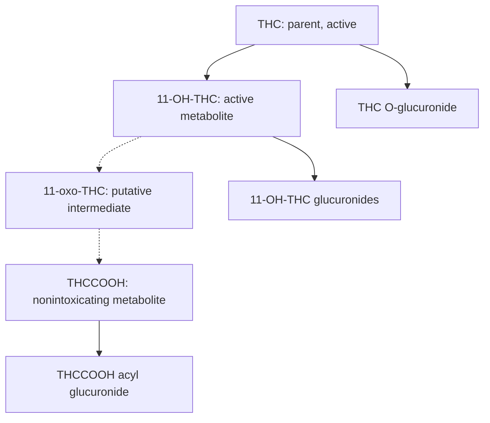

# THC chemistry for a pocket alcohol + cannabis device

**Research date:** 10 October 2026.  
**Status:** Background research supporting the proposed product; the repository's phase gates and normative specifications govern implementation. This review does not establish a validated assay, impairment model, regulatory status, or subscription cost.  
**PDF edition:** [THC_Chemistry_and_Pocket_Device_Research.pdf](THC_Chemistry_and_Pocket_Device_Research.pdf)

## Research scope and principal finding

This review examines which THC-related molecules are actually measured in blood, urine, oral fluid and breath, and how their chemistry affects a single pocket device with an app. It prioritizes original controlled human studies, analytical validation papers, mechanistic experiments, and original FDA/NIST documents. Evidence was checked through 10 October 2026. This is a critical research synthesis, not an exhaustive catalog of every proposed mass-spectrometric metabolite or a completed product validation.

**Development recommendation:** prioritize one reusable instrument containing a breath-alcohol channel and a reader for a replaceable saliva THC cartridge. Retain a common enclosure, battery, display and app. Investigate a second saliva THCCOOH channel only after establishing its additional information value and sensitivity requirements. This is an engineering judgment: the evidence supports saliva measurement and miniature integration, but does not establish the finished device's accuracy, cost, or impairment interpretation. [29,35,36]

The essential distinction is between three questions: whether a cannabinoid is present in the specimen; whether the result supports exposure or metabolism; and whether the person is functionally impaired. A test can answer the first question accurately without answering the third. Blood, urine and saliva sample different biological processes, so their concentrations cannot be interchanged. [7,9,20]

## 1. The core chemical pathway

Delta-9-tetrahydrocannabinol (Δ9-THC) is the parent drug, not a metabolite. Its major human oxidative products include **11-hydroxy-THC (11-OH-THC)** and **11-nor-9-carboxy-THC (THCCOOH or THC-COOH)**. The first remains psychoactive; the carboxy metabolite is nonintoxicating. Direct human administration established 11-OH-THC's psychoactivity decades ago; a universal claim that it is a fixed number of times more potent than THC would overstate that evidence. [1,5]

The useful functional-group map follows oxidation of the carbon-11 methyl group. The parent methyl becomes a hydroxymethyl group, then the acid through a proposed aldehyde intermediate. The aldehyde, often called 11-oxo-THC, should be labeled **putative/transient in this human pathway**, rather than presented as an established routine blood, urine or saliva biomarker. [2]

Dashed arrows denote the proposed aldehyde intermediate in the acid-forming pathway. Selected transformations are shown; the diagram is not an exhaustive metabolism map. [1–4]

This figure shows selected transformations, not all enzymes, metabolites or elimination routes. Glucuronidation can occur on the parent and hydroxylated compounds as well as on the acid; it is not a mandatory final step after every oxidation.

### What changing the functional group does

THC has a hydrophobic carbon framework, a pentyl side chain, a phenolic hydroxyl and an ether oxygen. Its structure favors lipid association and adsorption to some sampling materials. Adding the 11-hydroxyl changes hydrogen bonding while retaining much of that hydrophobic framework. Adding a carboxylic acid changes ionization behavior; at physiological pH, carboxylate character becomes important. Glucuronidation adds a glucuronic-acid residue with several hydroxyl groups and further changes polarity, size, charge and antibody recognition. These are structure–property deductions; they do not by themselves predict recovery from a particular cartridge. [3,25]

Consequently, the extraction chemistry that efficiently recovers parent THC need not recover THCCOOH or its conjugates equally. Removing salivary proteins, adding a surfactant, changing pH or shrinking the sample volume can alter the fraction available to the sensor. Surface binding can be useful for enrichment and troublesome when it causes uncontrolled sample loss or carryover. The entire fluid path must therefore be validated with the intended analyte. [12,25]

### Glucuronides are distinct chemical species

UGT enzymes transfer a glucuronic-acid group onto an available functional group. THC can form a phenolic O-glucuronide. THCCOOH forms an important **acyl glucuronide**, involving its carboxyl group. The distinction between a hydroxyl-linked glucuronide (conventionally described here as ether-type) and a carboxyl-linked acyl glucuronide (containing an ester linkage) affects hydrolysis and storage behavior. [3,15]

11-OH-THC has both phenolic and alcoholic hydroxyl groups. Hassenberg and colleagues synthesized an alcoholic 11-OH-THC glucuronide reference standard and confirmed that species in authentic serum and urine. They also observed a second major conjugate peak interpreted as a likely phenolic glucuronide; its exact assignment remained less secure without the corresponding reference standard. A peak with the expected mass is weaker evidence of exact structure than a standard-confirmed chromatographic match. [4]

## 2. Enzymes: what is established and what remains unresolved

**CYP2C9 is strongly supported for THC 11-hydroxylation.** CYP2C19 can contribute, while CYP3A4/5 also produce alternative oxidation products. The 2024 Yabut study showed that substrate concentration and binding to liver fatty-acid-binding protein, FABP1, affect measured pathway contributions. Percentages estimated in a particular microsomal experiment are not fixed percentages for every human being. Some additional chromatographic products in that work had proposed rather than fully confirmed structural assignments. [1]

A consequential 2023 result complicates the usual diagram that assigns all acid formation to P450 enzymes. Beers and colleagues found substantial formation of THCCOOH from 11-OH-THC in human liver cytosolic/S9 preparations, with strong NAD+-dependent contributions. Inhibitor experiments supported a role for aldehyde oxidase. The work did not resolve every reaction step or establish the fraction of whole-body clearance performed by each enzyme. It therefore supports a multistep oxidation pathway without justifying a simplistic, fully settled ADH/ALDH or CYP-only enzyme label. [2]

Original UGT experiments support UGT1A9/1A10 activity toward 11-OH-THC and UGT1A1/1A3 toward THCCOOH. Sensitive measurements also detected direct parent-THC glucuronidation. Later human intestinal microsome work identified UGT2B7 contributions to 11-OH-THC metabolism, showing why a liver-only enzyme list is incomplete. These are enzyme and tissue experiments, not validated predictors of a specific person's test result. [3,44]

For product development, variability in formation, further metabolism, distribution and past exposure means a metabolite/parent ratio is not a universal stopwatch. Even perfect chemical measurements need an independently validated interpretation model. A mechanistic model is valuable for designing that study, but its biological assumptions cannot be replaced by a large training set containing only purified standards.

## 3. Blood: the broadest established circulating panel

The important blood-related analytes are parent THC, active 11-OH-THC, nonintoxicating THCCOOH, and directly measurable glucuronides. Specialized assays also identify additional hydroxylated or reduced metabolites. Whole blood, plasma and serum must be named explicitly: plasma and serum exclude cells, while whole blood contains them. Protein association and unequal distribution between cells and plasma make a fixed conversion unreliable. [6,7]

### A bounded quantitative example

Schwope et al. studied ten adults after one 6.8%-THC cigarette and directly quantified free and glucuronidated compounds. The following are **median observed maxima**, not impairment cutoffs, typical values for all users, or matched physiological peak concentrations. The first observation was 0.25 h after smoking began; THC-glucuronide's reported maximum was at 0.5 h. [6]

| Analyte | Whole blood, ng/mL | Plasma, ng/mL |
|---|---:|---:|
| THC | 50 | 76 |
| 11-OH-THC | 6.4 | 10 |
| THCCOOH | 41 | 67 |
| THCCOOH-glucuronide | 89 | 190 |
| THC-glucuronide | 0.7 | 1.4 |

The source reports μg/L, exactly equivalent to ng/mL. Values are mass concentrations of different molecules; their relative heights are not automatically molar ratios. Low-abundance THC-glucuronide was not detected in every participant. [6]

### Route changes the profile

Inhaled THC reaches the circulation rapidly, followed by redistribution and metabolism. Oral delivery changes absorption and first-pass metabolism, with a larger role for 11-OH-THC relative to parent THC. A controlled 17-person brownie study using placebo, 10, 25 and 50 mg conditions found delayed blood THC/11-OH peaks while oral-fluid THC appeared immediately after eating. Those are different processes occurring in the same participants. [8]

An earlier 18-person brownie study observed substantial effects at higher doses despite whole-blood THC never exceeding 5 ng/mL. This is a direct counterexample to treating a single parent-THC blood concentration as a universal measure of effect across routes. The study's doses and sampling protocol define that observation; they are not instructions for interpreting an individual's future result. [9]

### Residual concentrations and specimen handling

Frequent use can leave a long declining concentration tail. In a monitored-abstinence study of 30 chronic daily users, two of the five participants still present on day 30 had blood THC of 0.3 ng/mL. The shrinking denominator matters. This establishes possible persistence under that study's sensitive measurement conditions, not a universal detection period or evidence of continuing acute intoxication. [10]

Storage can also change a measured metabolite profile. A study using authentic blood/plasma pools after controlled smoking found decreases in THC and THCCOOH-glucuronide and increases in THCCOOH under some storage conditions. A free/conjugate ratio can therefore change after collection. Any proposed ratio-based algorithm must validate collection tubes, temperature, delay to analysis and sample preparation as well as human biology. [16]

**Device implication:** blood is valuable for research on systemic exposure, but a saliva or breath sensor cannot simply estimate blood THC by multiplying its result by a constant. Collect paired matrices during development to test the relationship rather than assume it. [7,20]

## 4. Urine: predominantly an excretion signal

For routine cannabis testing, the key urinary target is THCCOOH-related material, especially its glucuronide. Parent THC and 11-OH-THC can be measured by specialized methods, often after deconjugation. Their reported presence must be interpreted in light of sample preparation. Urine does not provide a direct measurement of active drug at the brain. [11–13]

Huestis et al. compared smoked, vaporized and oral cannabis in 11 frequent and nine occasional users. Direct measurement showed THCCOOH-glucuronide was the predominant urinary analyte; free THC and 11-OH-THC were not detected by that study's method. This does not contradict studies reporting those analytes after hydrolysis: the chemical material presented to the instrument differs. [11]

### “Free,” “total” and “unbound” are different concepts

**Free in many analytical papers means unconjugated.** It does not mean unbound to protein. A selective direct assay for unconjugated THCCOOH excludes intact glucuronide. A cross-reactive screen must specify which compounds contribute to its signal. A protein-unbound measurement addresses a separate binding equilibrium.

**Total after hydrolysis means the specified aglycone released by that procedure plus any already unconjugated material.** It does not mean all cannabis metabolites, total absorbed dose, or all active cannabinoids. Alkaline and enzymatic hydrolysis do not recover every conjugate identically. Direct LC-MS/MS can quantify intact conjugates and unconjugated molecules separately, avoiding some hydrolysis ambiguity. [12,13]

If free THCCOOH and intact THCCOOH-glucuronide are combined computationally, the result needs a defined reporting basis. For aglycone-equivalent mass concentration, multiply the conjugate concentration by the molecular-mass ratio of aglycone to conjugate before adding. An unqualified sum of their ng/mL values combines different molecular masses and can mislead. This follows from stoichiometry; it is not a new biological calibration.

### Dilution, residual excretion and stability

Urine concentration depends on excreted analyte mass and water volume. Creatinine normalization can partly address dilution: ng/mL of THCCOOH divided by mg/mL of creatinine yields ng/mg. Original models for identifying new use from serial results incorporate elapsed time, starting concentration and population-specific rules. The correction does not create an impairment measurement. [14]

A monitored chronic-user study detected THC-related material in hydrolyzed urine for prolonged periods; the authors explicitly rejected urinary THC as a simple marker of a new dose. Thus, a specialized positive result cannot be interpreted solely from the word “THC” on the laboratory report. [13]

THCCOOH acyl glucuronide can undergo hydrolysis and acyl migration. Hanisch et al. demonstrated multiple isomeric conjugates and differences between authentic biological conjugate material and a commercial reference substance. This is a concrete reason to scrutinize standards, stereochemistry, storage and deconjugation when building a metabolite assay. [15]

**Device implication:** urine is useful for documenting exposure over an extended period. It is a poor match for the proposed quick pocket check when the desired information concerns current or very recent effects.

## 5. Saliva: the most useful noninvasive starting point, with distinct limitations

Oral fluid includes saliva plus material from oral surfaces and other local sources. It should not be treated as a tiny aliquot of plasma. Smoking, vaporization and chewed products can deposit THC directly in the mouth. This local reservoir can dominate a parent-THC result. [17,18]

### What is actually present

| Substance or group | Blood / plasma / serum | Urine | Oral fluid |
|---|---|---|---|
| Parent Δ9-THC | Established circulating analyte | Method-dependent; distinguish direct free measurement from hydrolyzed material | Principal practical target; strong contribution from mouth deposition |
| 11-OH-THC | Established active metabolite | Detectable with specialized methods, often after deconjugation | Often absent or low/intermittent at studied LOQs |
| THCCOOH | Established nonintoxicating metabolite | Major routine target, frequently conjugated | Present at much lower concentrations; often pg/mL analysis |
| THC-glucuronide | Directly measured, generally low in cited studies | Directly measurable | Not established here as a robust routine product target |
| THCCOOH-glucuronide | Directly measurable | Important, often dominant excretion form | Conjugated THCCOOH demonstrated; method and hydrolysis matter |
| 11-OH-THC glucuronides | Alcoholic species confirmed in serum; other assignments less certain | Alcoholic species confirmed in authentic urine | Insufficient evidence here for a reliable consumer target |

Presence does not mean every specimen is positive. Each cell summarizes evidence from its stated matrix, not a universal detection claim. The table draws on direct matrix studies and conjugate identification work. [4,6,11,12,18,19,22]

### Scale: parent THC versus a metabolite

Anizan's controlled smoking study included 14 frequent and ten occasional users. Median peak oral-fluid THC was 517 and 533 ng/mL, respectively, while median peak **free THCCOOH** was 126 and 24.4 pg/mL. Their respective quantification limits were 0.5 ng/mL and 15 pg/mL. The important design lesson is the unit scale, not that these group medians predict a particular person's concentration. [17]

**1 ng/mL = 1 μg/L = 1,000 pg/mL; 1 pg/mL = 1 ng/L.** A device that can measure tens of ng/mL of parent THC has not thereby demonstrated the ability to measure tens of pg/mL of THCCOOH. The latter may require much more selective enrichment, lower background and tighter contamination control.

11-OH-THC is attractive because it is active, but it is not currently the strongest saliva target. In the 20-person smoked/vaporized/brownie study, it was intermittent and was not detected beyond 1.5 h at a 0.2 ng/mL quantification limit. That is a study-specific analytical observation, not proof of universal absence. [18]

### The capsule-versus-chewed-edible problem

Milman et al. studied ten daily smokers receiving repeated swallowed dronabinol capsules. Across 440 oral-fluid specimens, THCCOOH was found in 432 and THC in 91, using different analyte-specific quantification limits. THC largely declined despite continued dosing, while THCCOOH increased. No 11-OH-THC was identified at 0.5 ng/mL. The comparison is not a head-to-head sensitivity comparison at an equal cutoff. It demonstrates why swallowed capsules and mouth-depositing products need separate validation. [19]

In a paired plasma/oral-fluid analysis, THC did not track plasma meaningfully; even the stronger THCCOOH association was too variable to predict concurrent plasma concentration. An app should therefore report the measured oral-fluid analyte, without labeling a calculated number “blood THC” unless that conversion has been independently validated for the intended population and route. [20]

Chewed brownies can produce an early mouth signal before systemic effects reach their maximum. Intact capsules can produce systemic exposure with a weak parent-THC mouth signal. These two cases create different failure modes for a simplistic “higher saliva value means more impaired” display. [8,9,19]

### What an added THCCOOH channel would contribute

THCCOOH is a product of metabolism, so it can strengthen evidence beyond direct parent-THC contamination. However, sensitive oral-fluid assays detect it during monitored abstinence in chronic users, and not every occasional user produces a detectable signal at a given threshold. It is therefore an exposure/metabolism channel, not a universal new-use clock. [17,21]

Free THCCOOH, intact conjugate and THCCOOH released after hydrolysis must be specified separately. Moore et al. demonstrated conjugated THCCOOH in oral fluid. Comparing a free-only study with one that hydrolyzed glucuronides can create an apparent biological difference that is actually methodological. Adding hydrolysis inside a cartridge introduces reagent, incubation and recovery requirements. [17,18,22]

### Passive exposure and other cannabinoids

A controlled secondhand-smoke study found oral-fluid THC in nonsmokers under intense chamber exposure. Total oral-fluid THCCOOH, measured after hydrolysis, was not detected at that study's 20 pg/mL quantification limit. This supports the metabolite's ability to reduce ambiguity from mouth contamination, but does not prove that every more-sensitive future assay can distinguish intentional use from systemic absorption during passive exposure. [24]

CBD, CBN and plant **THCA-A** are not interchangeable with THCCOOH. Plant THCA-A is a precursor that loses carbon dioxide to form THC on heating; the human carboxy metabolite results from oxidation at a different position. Older toxicology usage sometimes abbreviates the human carboxy metabolite as “THCA,” so full chemical names or structures are essential. CBD is a different cannabinoid; CBN can arise from oxidative degradation in the product and is not a reliable proof-of-metabolism marker. [23,31]

## 6. The sampling system is part of the chemistry

Reducing a collector from milliliters to microliters changes more than device size. It changes surface-area-to-volume ratio, wetting, available analyte mass, mixing and flow time. Matrix concentration also changes if the saliva-to-buffer ratio changes. These are engineering relationships that must be evaluated together rather than optimized independently.

**Collection volume and dilution.** Insufficient-volume collections occurred in controlled smoking work, where dry mouth complicated sampling. A fixed buffer volume creates greater dilution when less saliva is collected. For an illustrative calculation, 1 mL saliva plus 3 mL buffer gives fourfold dilution; 0.5 mL saliva in the same buffer gives sevenfold dilution. Applying a fourfold correction to the second specimen would underestimate the native concentration by about 43%, even with perfect recovery. This is calculated from dilution alone, not an observed error rate for a specific product. [17]

**Binding and recovery.** Molnar et al. found substantial THC loss to polypropylene and association with a protein-containing fraction in fortified oral fluid. Exact losses depended on volume and conditions. A protein-removal or filtration step may clean up a sample while removing target analyte. Surfactants may improve extraction but can also change antibody or electrode behavior; that compatibility is a design question. [25]

**Storage and environment.** Authentic-sample work shows that cannabinoid stability depends on the collection device, buffer and storage conditions. A published refrigerated-storage result does not validate a new cartridge in a hot car, and a dry reagent's shelf life is different from the stability of a collected specimen. [26]

**Minimum chemical specification.** Define native sample volume, dilution factor, recovery, final assay pH, target form, calibration standard, decision threshold, read time and invalid-result criteria. If any is unknown, a displayed numerical concentration can look more precise than the underlying measurement supports.

## 7. Additional metabolites: scientifically real, but different levels of evidence

THC metabolism extends beyond the principal three analytes. Gasse et al. examined 70 authentic plasma specimens and detected 8β-OH-THC in three and 8β,11-dihydroxy-THC in 37. Most quantified results were for the dihydroxy species. Their existence in human specimens is established; superiority as a pocket-device target or a validated impairment classifier is not. [27]

A 2023 study combined forensic blood analysis with human liver microsomes and reported evidence that reduced products, including 11-OH-HHC and HHC-COOH, can arise along THC-related metabolic pathways. Some concentrations were estimated and exposure histories were uncontrolled. These findings complicate the assumption that every HHC-metabolite signal uniquely proves ingestion of an HHC product. They are an emerging branch, not a recommended first assay target. [28]

Other ring hydroxylations, epoxides, side-chain oxidations and conjugates appear in mechanistic literature. An in-vitro chromatographic peak with a proposed structure is not equivalent to a standard-confirmed molecule found repeatedly in living users' specimens. A defensible development database should record matrix, confirmation method and certainty for every proposed marker, including negative evidence and assay detection limits. [1,4]

## 8. Breath: new 2026 evidence on vapor–aerosol partitioning

THC breath measurement cannot be modeled simply as an ethanol sensor with a different label. Target amounts are far smaller and collection, extraction and phase partitioning remain central. Many studies report **mass per collected sample**, such as pg/device, rather than a directly comparable gas concentration. [32,33]

### Low volatility does not mean aerosol-only transport

NIST's 2026 study measured pure-cannabinoid vapor pressures at 364–424 K and extrapolated to breath temperature. Its equilibrium model predicted substantial, often predominant, vapor-phase THC under selected conditions. The phase balance changed strongly with aerosol loading and temperature. The calculation assumed an activity coefficient of one and equilibrium partitioning, without resolving partition kinetics. These were model predictions, not direct measurements of vapor/aerosol fractions in people. Thus, both “THC travels only in particles” and “human breath THC is proven mostly vapor” are overstatements. A collector should investigate both phases. [31]

Pure-compound saturation vapor pressure is not a person's breath partial pressure. The latter depends on concentration and activity in biological material, mass transfer, temperature, breathing and collection. This distinction matters when converting thermodynamic measurements into a practical sensor specification.

### What human collection studies actually establish

The 2023 NIST impaction-filter pilot studied 18 participants and 42 samples. THC was detectable in some baseline specimens as well as after smoking. Detection limits varied by batch in the pg/device range. Its particular filter also showed low THC recovery in a fortification experiment. These are reasons to treat collection as a quantitative component, not a passive accessory. [32]

A 2024 NIST condensate study detected THC after inhalation using collection followed by laboratory processing and mass spectrometry. Condensate can contain material from vapor and aerosols, but does not automatically reveal the fraction originally present in each phase. This supports breath sampling while leaving a substantial integration challenge. [33]

In NIST's 2025 edible study, 19 of 29 participants showed a significant increase in breath THC concentration at one or more post-use time points, four no change and six only decreases; baseline signals were common. Breath detection after edibles challenges a smoke-residue-only explanation. The study does not establish a universal threshold for recent use or impairment. A 2026 correction changed the first author's surname, not the scientific results. [34]

**Development judgment:** breath THC is worth a separate collection-and-analysis research track. Saliva offers the stronger near-term basis for a low-cost integrated product because there is already direct assay and user-sample evidence; the breath approach still needs a defensible acquisition method before a small transducer alone solves the problem.

## 9. Sensing chemistry and the quality of the evidence

A sensing system has three layers: obtaining a representative specimen, recognizing the target molecule, and converting recognition into a signal. A color change, current or impedance shift proves neither exact molecular identity nor the interpretation claimed by the app.

### Reference measurement: LC-MS/MS

Liquid chromatography separates molecules before tandem mass spectrometry evaluates ion transitions. Validated assays use matrix-matched calibration, appropriate internal standards, retention-time and ion-ratio criteria, and recovery/stability checks. Intact glucuronides can be measured directly or the procedure can deliberately hydrolyze them; these are distinct assay designs. [12,45]

Closely related cannabinoids can have the same mass or overlapping fragments. An exact mass alone does not identify every isomer. A recent urine method explicitly addressed separation of Δ8- and Δ9-related metabolites and isomers, illustrating why “mass spectrometry confirmed THC” is incomplete without knowing the separation and analyte panel. [46]

For this device, the finished cartridge should be compared with a validated reference assay on the same specimen and the same chemical target. A separate blood sample can support a pharmacokinetic study, but it should not substitute for a same-matrix reference when estimating the cartridge's analytical accuracy.

### Competitive immunochemistry and optical readers

THC is a small molecule, so competitive binding formats are practical: sample THC competes for a limited number of antibody binding sites. Increasing analyte reduces the test-line signal. For the cited qualitative assay, a preliminary positive requires a control line with no test line; a faint visible test line is interpreted as negative. Reader-based numerical thresholds require their own validation. A reader can standardize timing and optical interpretation; it does not remove cross-reactivity or matrix effects. [29,30]

FDA's 2026 K252523 review provides a real OTC oral-fluid benchmark with a 40 ng/mL Δ9-THC cutoff and preliminary qualitative results. Native specimens from the cutoff to 50% above it showed 33/38 positive agreement. The lay study involved people testing partners; it explicitly reports that no one self-tested. This supports an OTC assay pathway while leaving the proposed solo collection/reader/app workflow to validate. [29]

The predicate K223162 makes selectivity tangible. Its THC channel responded to the following concentrations; these are **assay-specific cross-reactivity results**, not typical biological concentrations or impairment limits. [30]

| Challenge compound | Concentration producing a THC-positive result |
|---|---:|
| Δ9-THC | 40 ng/mL |
| Δ8-THC | 80 ng/mL |
| THCCOOH | 4 ng/mL |
| 11-OH-THC | 45 ng/mL |
| CBN | 200 ng/mL |
| CBD | 2,200 ng/mL |

Thus, a calibrated “THC” screen is not automatically chemically exclusive to free Δ9-THC. Cross-reactivity to THCCOOH at 4 ng/mL also does not equal dedicated metabolite sensitivity at tens of pg/mL. [30]

**EPOCH provides a useful advanced optical precedent.** The 2021 system used a competitive membrane assay with optical transmission. Its user pilot included 40 smokers, three THC-jelly consumers and 43 controls, with users sampled within ten minutes of consumption. This supports real-sample feasibility, but the immediate-use design does not establish later near-cutoff performance. Its GC-MS comparison used serially diluted THCV standards and a corresponding THCV membrane assay; it did not provide paired confirmatory native-THC measurements for the user cohort. [35]

### Electrochemical sensing

Direct phenolic oxidation, a mediated chemical reaction, antibody-based impedance and aptamer-based competitive signaling are different mechanisms. A small potentiostat can read them, but their selectivity and specimen preparation requirements differ.

Mishra's 2020 ring combined a carbon-nanotube/carbon THC electrode with an alcohol-oxidase/Prussian-blue ethanol channel in a replaceable cap and wireless enclosure. It measured both in diluted saliva within three minutes under experimental conditions. This is strong miniature-integration precedent, without establishing population-level accuracy for a finished consumer device. [36]

Wanklyn's mediated electrode detected fortified THC in undiluted saliva within 30 seconds, yet a four-smoker pilot yielded only 28% sensitivity. The study involved repeated sensor readings, not hundreds of independent participants. It is a concrete example of successful analytical chemistry that still needed major improvement in user samples. [37]

Another widely cited 2019 impedance sensor used THC-BSA conjugate in key experiments. Protein-conjugated THC is not equivalent to free native THC, so that work's headline sensitivity should not be transferred directly to a consumer cartridge. The complete incubation and preparation time also matters, beyond the speed of one electrical scan. [38]

A 2023 aptamer/methylene-blue microfluidic system illustrates matrix penalties: its reported 1 nM detection limit in buffer worsened tenfold in 10% raw saliva. Filtration improved performance, but dilution and recovery must be included when converting final-mixture sensitivity to a native-saliva specification. Short-term storage and reuse experiments did not establish a retail cartridge lifetime. [39]

### Color reactions, Raman and other approaches

Fast Blue reagents react with cannabinoid phenolic chemistry, but the response is not intrinsically THC-specific. A 2026 NIJ project tested liquid standards on films/gels and obtained preliminary color responses in the 10–100 ng range; THC and CBN overlapped. That does not demonstrate a validated breath assay at the much smaller collected masses encountered in many studies. [40]

Raman/SERS can provide more molecular information than one color, but performance depends on adsorption, substrate reproducibility and matrix background. A 2019 study included saliva from two actual users, while its urine analysis needed chromatographic cleanup. This is useful research evidence, not broad validation of a pocket diagnostic. [41]

Molecularly imprinted polymers, nanomaterial transistors and infrared/ion-mobility systems remain candidates to evaluate against the same standards. Device size or a low theoretical detection limit cannot substitute for real-sample selectivity, manufacturing reproducibility, regeneration and a validated decision threshold. For example, a 2019 nanotube breath study used analytical vapors and collected exhaled smoke; that is a narrower demonstration than a field test across routes and post-use times. [42]

Machine learning can address donor and interferent variation when the underlying signals contain useful information. A 2024 dual THC/CBD electrode study explored this in fortified donor saliva. Prospective validation must keep new donors, new cartridge lots and realistic mixed exposures outside training; otherwise an impressive classifier may learn preparation artifacts. This is a validation requirement, not a judgment that algorithms cannot help. [43]

## 10. What to build, and what must be proven

### Recommended first architecture

Keep one pocket instrument. Put a breath-alcohol measurement path and an enclosed saliva THC assay path inside the same product, with shared power, processor, display and mobile connection. Use a replaceable saliva cartridge for collection, conditioning, recognition chemistry and contaminated surfaces. The chemistry can be consumable while the instrument remains reusable.

An optical competitive assay is the leading baseline to compare against an electrochemical alternative. The choice should follow native-sample data, cartridge cost, precision near the decision threshold, shelf life and ease of self-collection. The miniature dual-saliva ring is a useful second architecture to investigate, but saliva alcohol would require its own intended-use validation. [29,35,36]

Reserve physical or electronic capacity for a future THCCOOH channel, but do not promise it at launch. Its value must be tested: does it resolve a meaningful ambiguity often enough to justify picogram-scale sensitivity, more reagent complexity and potentially persistent positives? The answer depends on the user's intended question, not just whether the molecule is scientifically interesting.

### A staged validation program

1. **Define the claim and measurand.** Specify parent Δ9-THC or a defined cross-reactive screen, native oral fluid or processed mixture, qualitative cutoff or quantitative range, and permitted interpretation. Include an invalid state.
2. **Benchmark collection before optimizing the detector.** Measure volume, dilution, extraction recovery, adsorption, dry-mouth failure and loss during any filtration. Test the assembled fluid path.
3. **Compare candidate chemistries against a reference.** Use certified standards and validated LC-MS/MS on the same native specimens. Report agreement and uncertainty near the chosen cutoff.
4. **Recruit the populations that expose failure modes.** Include smoking, vaporization, chewed edibles, swallowed capsules, occasional/frequent use, baseline positives and low-volume samples. Analyze performance by subgroup.
5. **Challenge specificity and co-use.** Test Δ8-THC, CBD, CBN, relevant metabolites/conjugates, ethanol and common oral-matrix constituents in plausible mixtures. Validate the two channels operating together.
6. **Test manufacturing and real use.** Include cartridge lots, temperature/humidity, aging, drop/transport conditions, high-positive carryover, solo self-collection and the exact reader/app workflow. Report invalids and retries in the denominator.
7. **Validate any higher-level interpretation separately.** A recent-use or impairment algorithm needs prospective outcome data. Do not relabel concentration accuracy as accuracy for an individual's fitness to drive.

These are proposed development gates, not a claim that the literature has already satisfied them for this design.

### The $20/month target

The chemistry research does not establish a viable price yet. Consumables are likely to be a central cost because capture surfaces, reagents and contaminated paths may need replacement. Monthly contribution depends on the number of tests used, landed cartridge cost, shipping, hardware recovery, quality control and support. A reusable surface would still carry regeneration, fouling, drift and lifetime-validation costs. Treat $20/month as a design constraint to test with supplier quotations and real usage, not a cost proven by a laboratory electrode demonstration.

**The actionable scientific direction is a defined oral-fluid THC measurement inside your single alcohol/THC instrument, with metabolite sensing as an evidence-driven extension.** The opportunity lies in reliable sampling, selective chemistry, a useful price and honest interpretation. More precise measurement of the same marker cannot, by itself, remove ambiguity arising from that marker's biology.

## References and evidence roles

[1] Yabut et al. (2024). CYP2C9, CYP3A and CYP2C19 metabolize Δ9-tetrahydrocannabinol to multiple metabolites but metabolism is affected by human liver fatty acid binding protein (FABP1). Mechanistic human enzyme/microsome study. https://doi.org/10.1016/j.bcp.2024.116191

[2] Beers et al. (2023). Cytosolic Enzymes Generate Cannabinoid Metabolites 7-Carboxycannabidiol and 11-Nor-9-carboxytetrahydrocannabinol. Human liver fraction experiments; acid-forming mechanism. https://doi.org/10.1021/acsmedchemlett.3c00017

[3] Mazur et al. (2009). Characterization of Human Hepatic and Extrahepatic UDP-Glucuronosyltransferase Enzymes Involved in the Metabolism of Classic Cannabinoids. Recombinant UGT experiments. https://doi.org/10.1124/dmd.109.026898

[4] Hassenberg et al. (2020). Investigation of phase II metabolism of 11-hydroxy-Δ9-tetrahydrocannabinol and metabolite verification by chemical synthesis of 11-hydroxy-Δ9-tetrahydrocannabinol-glucuronide. Structural identification and authentic specimens. https://doi.org/10.1007/s00414-020-02387-w

[5] Lemberger et al. (1973). Comparative Pharmacology of Δ9-Tetrahydrocannabinol and its Metabolite, 11-OH-Δ9-Tetrahydrocannabinol. Controlled human pharmacology. https://doi.org/10.1172/JCI107431

[6] Schwope et al. (2011). Identification of Recent Cannabis Use: Whole-Blood and Plasma Free and Glucuronidated Cannabinoid Pharmacokinetics following Controlled Smoked Cannabis Administration. https://doi.org/10.1373/clinchem.2011.171777

[7] Schwilke et al. (2009). Intra- and Intersubject Whole Blood/Plasma Cannabinoid Ratios Determined by 2-Dimensional, Electron Impact GC-MS with Cryofocusing. Paired-matrix variability. https://doi.org/10.1373/clinchem.2008.114405

[8] Spindle et al. (2020). Pharmacokinetics of Cannabis Brownies: A Controlled Examination of Δ9-Tetrahydrocannabinol and Metabolites in Blood and Oral Fluid of Healthy Adult Males and Females. https://doi.org/10.1093/jat/bkaa067

[9] Vandrey et al. (2017). Pharmacokinetic Profile of Oral Cannabis in Humans: Blood and Oral Fluid Disposition and Relation to Pharmacodynamic Outcomes. https://doi.org/10.1093/jat/bkx012

[10] Bergamaschi et al. (2013). Impact of Prolonged Cannabinoid Excretion in Chronic Daily Cannabis Smokers' Blood on Per Se Drugged Driving Laws. Monitored abstinence. https://doi.org/10.1373/clinchem.2012.195503

[11] Huestis et al. (2020). Free and Glucuronide Urine Cannabinoids after Controlled Smoked, Vaporized and Oral Cannabis Administration in Frequent and Occasional Cannabis Users. https://doi.org/10.1093/jat/bkaa046

[12] Scheidweiler, Desrosiers and Huestis (2012). Simultaneous Quantification of Free and Glucuronidated Cannabinoids in Human Urine by Liquid Chromatography-Tandem Mass Spectrometry. https://doi.org/10.1016/j.cca.2012.06.034

[13] Lowe et al. (2009). Extended Urinary Δ9-Tetrahydrocannabinol Excretion in Chronic Cannabis Users Precludes Use as a Biomarker of New Drug Exposure. Hydrolyzed urinary measurements. https://doi.org/10.1016/j.drugalcdep.2009.05.027

[14] Schwilke et al. (2011). Differentiating new cannabis use from residual urinary cannabinoid excretion in chronic, daily cannabis users. Serial creatinine-normalized modeling. https://doi.org/10.1111/j.1360-0443.2010.03228.x

[15] Hanisch, Paulke and Toennes (2017). 11-nor-9-carboxy-Δ9-tetrahydrocannabinol glucuronide exhibits acyl-migration isomers. https://doi.org/10.1016/j.jpba.2017.08.044

[16] Scheidweiler et al. (2013). In Vitro Stability of Free and Glucuronidated Cannabinoids in Blood and Plasma Following Controlled Smoked Cannabis. https://doi.org/10.1373/clinchem.2012.201467

[17] Anizan et al. (2013). Oral fluid cannabinoid concentrations following controlled smoked cannabis in chronic frequent and occasional smokers. https://doi.org/10.1007/s00216-013-7291-5

[18] Swortwood et al. (2017). Cannabinoid disposition in oral fluid after controlled smoked, vaporized, and oral cannabis administration. Includes hydrolyzed THCCOOH. https://doi.org/10.1002/dta.2092

[19] Milman et al. (2010). Disposition of Cannabinoids in Oral Fluid after Controlled Around-the-Clock Oral THC Administration. Swallowed dronabinol. https://doi.org/10.1373/clinchem.2009.141853

[20] Milman et al. (2011). Oral Fluid and Plasma Cannabinoid Ratios after Around-the-Clock Controlled Oral Δ9-Tetrahydrocannabinol Administration. https://doi.org/10.1373/clinchem.2011.169490

[21] Lee et al. (2011). Oral fluid cannabinoids in chronic, daily Cannabis smokers during sustained, monitored abstinence. https://doi.org/10.1373/clinchem.2011.164822

[22] Moore et al. (2007). Detection of conjugated 11-nor-Δ9-tetrahydrocannabinol-9-carboxylic acid in oral fluid. https://doi.org/10.1093/jat/31.4.187

[23] Moore, Rana and Coulter (2007). Simultaneous identification of 2-carboxy-tetrahydrocannabinol, tetrahydrocannabinol, cannabinol and cannabidiol in oral fluid. Plant-acid distinction. https://doi.org/10.1016/j.jchromb.2007.02.016

[24] Cone et al. (2015). Nonsmoker Exposure to Secondhand Cannabis Smoke. III. Oral Fluid and Blood Drug Concentrations and Corresponding Subjective Effects. https://doi.org/10.1093/jat/bkv070

[25] Molnar, Lewis and Fu (2013). Recovery of spiked Δ9-tetrahydrocannabinol in oral fluid from polypropylene containers. Matrix and sampling-material effects. https://doi.org/10.1016/j.forsciint.2012.11.006

[26] Lee et al. (2012). Cannabinoid Stability in Authentic Oral Fluid after Controlled Cannabis Smoking. https://doi.org/10.1373/clinchem.2012.184929

[27] Gasse et al. (2018; online 2017). 8β-OH-THC and 8β,11-diOH-THC: minor metabolites with major informative value? Authentic plasma. https://doi.org/10.1007/s00414-017-1692-5

[28] Jørgensen et al. (2023). Evidence of 11-Hydroxy-hexahydrocannabinol and 11-Nor-9-carboxy-hexahydrocannabinol as Novel Human Metabolites of Δ9-Tetrahydrocannabinol. https://doi.org/10.3390/metabo13121169

[29] FDA (2026). K252523: OTC oral-fluid drug-test substantial-equivalence decision summary. Original regulatory review and lay-user evidence. https://www.accessdata.fda.gov/cdrh_docs/reviews/K252523.pdf

[30] FDA (2023). K223162: oral-fluid drug-test decision summary. Predicate method, analytical cross-reactivity and collection/read-time evidence. https://www.accessdata.fda.gov/cdrh_docs/reviews/K223162.pdf

[31] Beuning et al. (2026). Vapor pressure measurements on Δ9-tetrahydrocannabinol, cannabidiol, and cannabinol to inform cannabis breathalyzer development. Thermodynamic measurements and phase-partition model. https://doi.org/10.1088/1752-7163/ae3794

[32] Jeerage et al. (2023). THC in breath aerosols collected with an impaction filter device before and after legal-market product inhalation: a pilot study. https://doi.org/10.1088/1752-7163/acd410

[33] Berry et al. (2024). Cannabinoids detected in exhaled breath condensate after cannabis use. Original NIST condensate pilot. https://doi.org/10.1088/1752-7163/ad6347

[34] Berry et al. (2025). The detection of cannabinoids in breath after ingestion of cannabis-infused edibles. Original NIST human study. https://doi.org/10.1093/jat/bkaf063 ; author-name correction (2026): https://doi.org/10.1093/jat/bkag018

[35] Yu et al. (2021). A rapid assay provides on-site quantification of tetrahydrocannabinol in oral fluid. EPOCH optical competitive assay and immediate-use pilot. https://doi.org/10.1126/scitranslmed.abe2352

[36] Mishra et al. (2020). Simultaneous detection of salivary Δ9-tetrahydrocannabinol and alcohol using a Wearable Electrochemical Ring Sensor. https://doi.org/10.1016/j.talanta.2020.120757

[37] Wanklyn et al. (2016). Disposable screen printed sensor for the electrochemical detection of delta-9-tetrahydrocannabinol in undiluted saliva. https://doi.org/10.1186/s13065-016-0148-1

[38] Stevenson et al. (2019). A Rapid Response Electrochemical Biosensor for Detecting THC in Saliva. THC-BSA and fortified-sample experiments. https://doi.org/10.1038/s41598-019-49185-y

[39] Kékedy-Nagy et al. (2023). An electrochemical aptasensor for Δ9-tetrahydrocannabinol detection in saliva on a microfluidic platform. https://doi.org/10.1016/j.bios.2022.114998

[40] Alves / NIJ (2026). Development of a THC Breath Analyzer Using Chitosan Film with Colorimetric Dye. Research report NCJ 311645; liquid-standard experiments. https://www.ojp.gov/library/publications/development-thc-breath-analyzer-using-chitosan-film-colorimetric-dye

[41] Sivashanmugan et al. (2019). Tetrahydrocannabinol Sensing in Complex Biofluid with Portable Raman Spectrometer Using Diatomaceous SERS Substrates. Original SERS study. https://doi.org/10.3390/bios9040125

[42] Hwang et al. (2019). Tetrahydrocannabinol detection using semiconductor-enriched single-walled carbon nanotube chemiresistors. Analytical vapor and exhaled-smoke experiments. https://doi.org/10.1021/acssensors.9b00762

[43] Ortega et al. (2024). Ultra-low dual detection of tetrahydrocannabinol and cannabidiol in saliva based on electrochemical sensing and machine learning: overcoming cross-interferences and saliva-to-saliva variations. https://doi.org/10.1039/D4SD00102H

[44] Kumar et al. (2022). Characterizing and Quantifying Extrahepatic Metabolism of (−)-Δ9-Tetrahydrocannabinol (THC) and Its Psychoactive Metabolite, (±)-11-Hydroxy-Δ9-THC (11-OH-THC). Human tissue/microsome experiments. https://doi.org/10.1124/dmd.122.000868

[45] Scheidweiler et al. (2013). 11-Nor-9-carboxy-Δ9-tetrahydrocannabinol quantification in human oral fluid by liquid chromatography–tandem mass spectrometry. https://doi.org/10.1007/s00216-013-7027-6

[46] Quantitative analysis of Δ8- and Δ9-tetrahydrocannabinol metabolites and isomers: a rapid assay in urine by LC-MS/MS (2025). Primary analytical-method paper. https://pubmed.ncbi.nlm.nih.gov/39847096/

### Reading the evidence correctly

The reference list includes controlled human studies, uncontrolled authentic-specimen studies, in-vitro mechanistic experiments and regulatory reviews. They answer different questions. A proof-of-concept device's reported detection limit is not a population sensitivity estimate. A metabolite identified in liver microsomes is not automatically an abundant salivary biomarker. A regulatory clearance applies to the reviewed assay and intended use; it does not transfer to a redesigned reader or combined device.

Numeric examples retain their matrix, population and assay context. No universal clearance chart is provided because route, past exposure, specimen collection, analytical target and cutoff materially change the answer. Product architecture and validation recommendations are the author's synthesis from the cited evidence.
